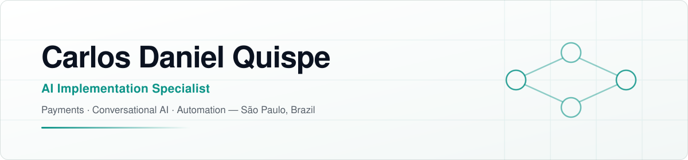
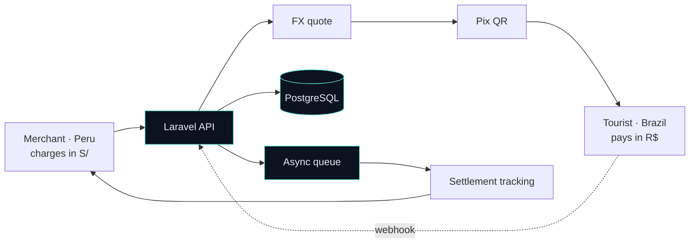
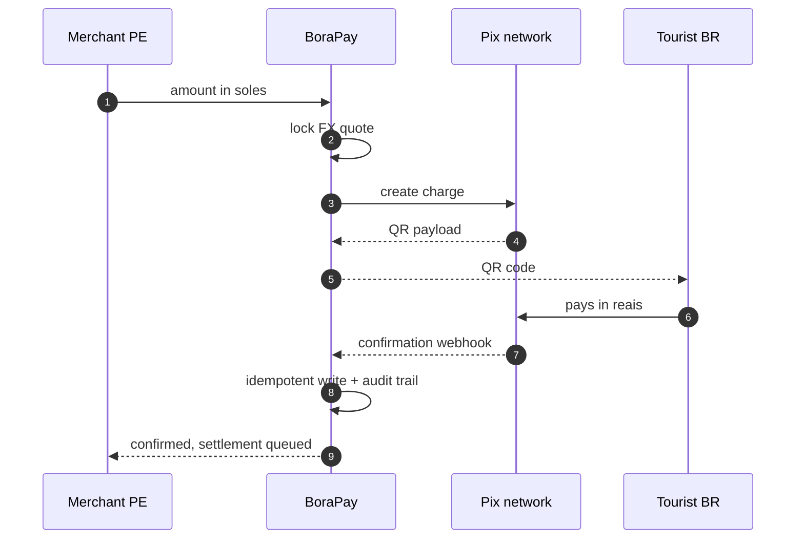

<picture>
  <source media="(prefers-color-scheme: dark)" srcset="assets/banner-dark.svg">
  <source media="(prefers-color-scheme: light)" srcset="assets/banner-light.svg">
  
</picture>

  
  
  

  <b>Payments</b> · <b>Conversational AI</b> · <b>Automation</b> — São Paulo, Brazil

---

I build web software that moves money, answers customers and removes manual work.

> [!NOTE]
> **Most of my work lives in private repositories.** The contribution graph below is
> real, but the code behind it is closed — client systems and a payments product in
> production. What I *can* show, I show here.

 

## BoraPay

<table>
<tr>
<td width="60%" valign="top">

**Cross-border Pix[^pix] infrastructure between Brazil and Peru.**

A merchant in Peru charges in soles. A tourist from Brazil pays with Pix in
reais. BoraPay quotes the rate, generates the QR, confirms the payment and
tracks settlement into the merchant's local bank account.

Built end to end — architecture, data modelling, integrations, deploys and
production maintenance.

**In production, with real merchants.**

</td>
<td width="40%" valign="top">

| | |
|:--|:--|
| **Backend** | Laravel |
| **Frontend** | Vue + Inertia |
| **Data** | PostgreSQL |
| **Infra** | Laravel Cloud · Cloudflare Edge |
| **Rails** | Pix |

</td>
</tr>
</table>

<b>How a single charge actually flows</b>

 

Engineering concerns that shape the system: **idempotent webhook handling**
(the network retries), **async queues** for anything slower than a request,
**traceability** on every state change, and **failure handling** that never
leaves a charge in an unknown state.

 

## Stack

| | |
|:--|:--|
| **Backend** | PHP · Laravel · PostgreSQL · REST APIs · queues · webhooks |
| **Frontend** | Vue · Inertia · TypeScript · Tailwind |
| **AI** | Generative AI APIs · conversational agents · WhatsApp integrations |
| **Infra** | Laravel Cloud · Cloudflare · Git |

 

<b>Background</b>

 

**AI Implementation Specialist** — YaVendió, São Paulo &nbsp;·&nbsp; current
Conversational AI for commerce: agent configuration, WhatsApp integration,
catalog structuring, commercial flow validation and merchant onboarding.

**Full-stack developer** — BoraPay &nbsp;·&nbsp; independent project
Cross-border Pix payment flows between Brazil and Peru.

**Studying** — Data Science & AI Engineering, SENATI
**Certified** — Meta · *Facilitate client onboarding to WhatsApp for Business*

**Languages** — Spanish native · Portuguese professional · English

<b>Also building</b>

 

**[danielquispe.dev](https://danielquispe.dev)** — personal site and technical
writing. Work in progress.

 

---

  Open to interesting problems in payments, messaging and automation. 
  <a href="mailto:hello@danielquispe.dev">hello@danielquispe.dev</a>

[^pix]: Pix is Brazil's instant payment system, run by the central bank. Over 700 financial institutions support it, and it settles in seconds.
